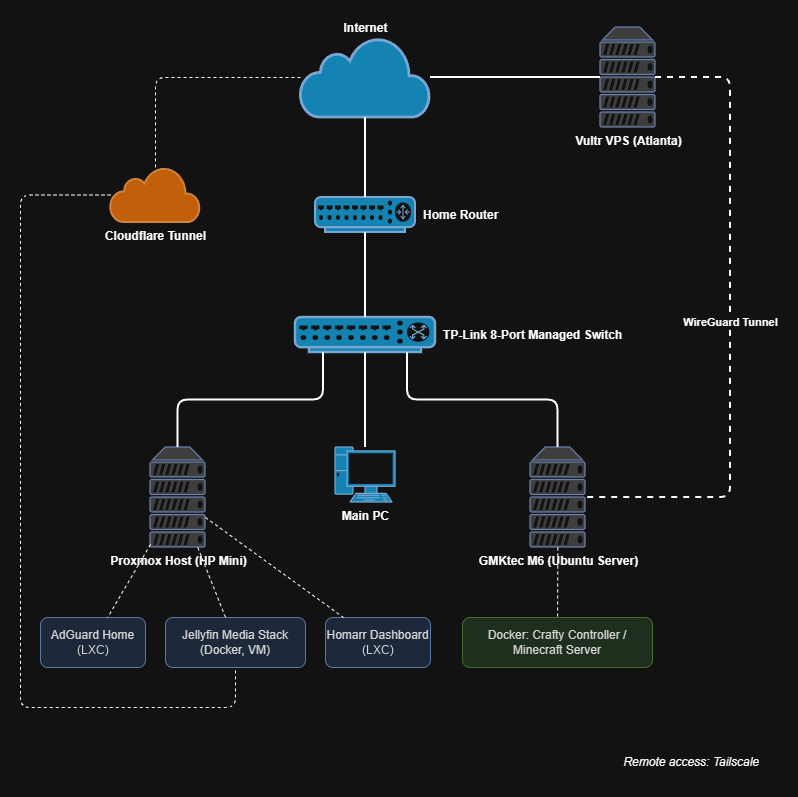
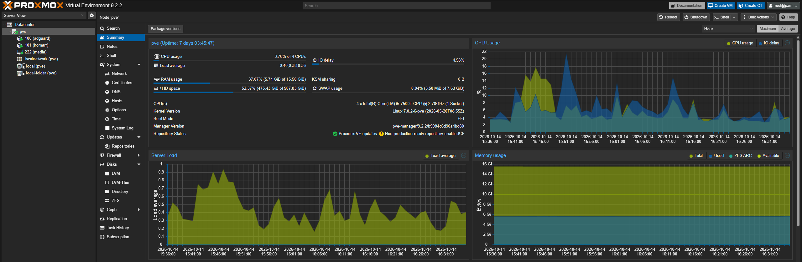
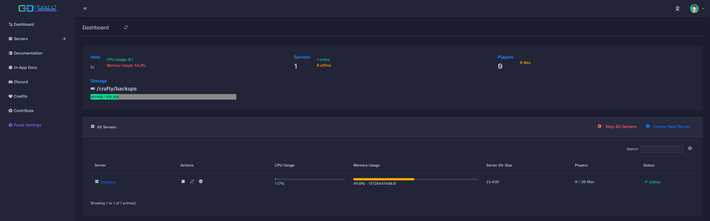
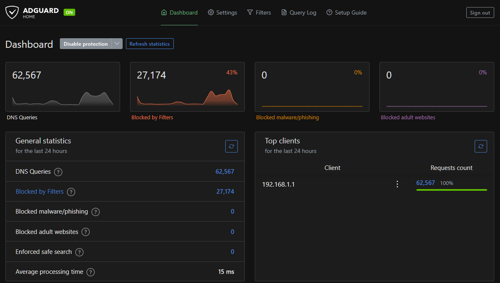

# Homelab

This is my home lab. I use it to learn IT skills hands-on and to host a few services for myself and my friends. I'm currently studying Computer Technology at Greenville Technical College, and most of what's here I learned by setting it up, breaking it, and fixing it.

## Hardware

| Device | Specs | Role |
|---|---|---|
| GMKtec M6 Ultra | Ryzen 5 7640HS, 32GB RAM, 1TB SSD | Ubuntu Server + Docker (Minecraft server) |
| HP EliteDesk/ProDesk 600 G3 Mini | Intel i5-7500T, 16GB RAM | Proxmox host (VM and LXC containers) |
| TP-Link 8-port Easy Smart switch | Managed switch | Connects the lab |
| Vultr VPS (Atlanta) | Cloud server | Public IP for the Minecraft server |

## Network Diagram

## Services

### Proxmox VE
Runs my services in a mix of LXC containers and a full virtual machine, so I can keep services separate and spin up test machines without touching the rest of the lab. Lightweight services like AdGuard and Homarr run as LXC containers, which share the host's kernel and use very few resources. The media stack runs in a full VM.

### AdGuard Home
Runs in an LXC container on the Proxmox host. Network-wide DNS filtering that blocks ads and trackers for every device on my network. In one 24-hour period it handled about 62,000 DNS queries and blocked 43% of them.

### Jellyfin Media Stack (Docker Compose)
Runs in a VM on the Proxmox host. A multi-container media stack managed with Docker Compose, built around Jellyfin as the media server. The containers share common settings (restart policy, logging, user IDs, time zone) through a YAML anchor so I don't repeat the same config in every service. Remote access to Jellyfin goes through a Cloudflare Tunnel on my own domain, so I didn't have to open any ports on my router.

### Homarr
Runs in an LXC container on the Proxmox host. A dashboard that links to all my services in one place, so I don't have to remember every IP and port.

### Tailscale
Mesh VPN I use for secure remote access to the lab when I'm away from home.

### Minecraft Server (Crafty Controller in Docker)
A modded server (Craftoria modpack) that I host for friends. It runs in Docker on Ubuntu Server and is managed through Crafty Controller.

My home internet doesn't give me a usable public IP, so I rented a small VPS on Vultr and connected it to the M6 over a WireGuard tunnel. Players connect to the VPS, and traffic is forwarded through the tunnel to the server at my house.

## Screenshots

**Proxmox**

**Crafty Controller**

**AdGuard Home**

## Problems I Ran Into

### Docker container name conflict
When I added a new service to my Docker Compose stack, it failed because an older container with the same name was still there from when I ran it manually. I removed the old container with `docker rm -f` and brought the stack back up with `docker compose up -d`.

### YAML indentation error
My first attempt at adding a service put it under the `networks:` section instead of `services:`, which broke the whole compose file. Lesson learned about how strict YAML indentation is.

### Jellyfin audio drifting out of sync
Videos played fine from the start but drifted out of sync after resuming or seeking. I used `ffprobe` to check whether the files had a variable frame rate and checked the Jellyfin dashboard to see whether it was direct playing or transcoding.

## What I Want to Add Next

- Active Directory lab with Windows Server and a domain-joined Windows 11 VM
- Proxmox Backup Server, with a tested restore
- Monitoring (Uptime Kuma)
- Scripts to automate common tasks

## Files

- [`media/docker-compose.yml`](media/docker-compose.yml): Jellyfin media stack
- [`minecraft/docker-compose.yml`](minecraft/docker-compose.yml): Crafty Controller for the Minecraft server
- [`screenshots/`](screenshots/): Proxmox, Crafty, and AdGuard dashboards

